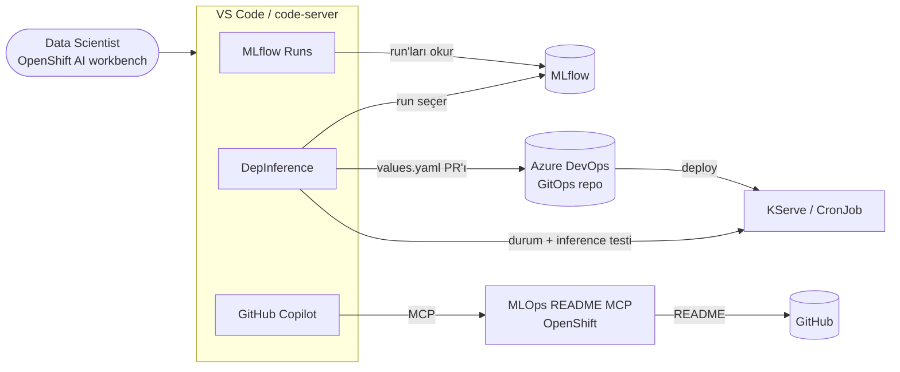

# ML Platform

**OpenShift AI** üzerinde çalışan data science ekiplerinin günlük işini kolaylaştıran araçlar: deney takibi, model deployment'ı ve yapay zekâ asistanı desteği.

Bu repo birbirinden bağımsız kurulabilen üç bileşen içerir. Hepsinin ortak hedefi data scientist'in YAML yazmadan, workbench'ten çıkmadan ve platform ekibine ticket açmadan iş yapabilmesidir.

| Bileşen | Ne işe yarar? | Teknoloji | Klasör |
|---|---|---|---|
| **MLflow Runs** | Namespace'e ait MLflow run'larını VS Code içinde listeler, yan yana karşılaştırır, metrikleri görselleştirir. | VS Code extension (TypeScript) | [`extensions/mlflow-code`](extensions/mlflow-code) |
| **DepInference** | MLflow'daki bir run'ı seçip GitOps reposuna online (KServe) ya da batch (CronJob) deployment PR'ı açar. Model hazır olunca playground'dan test edilir. | VS Code extension (TypeScript) | [`extensions/DepInference`](extensions/DepInference) |
| **MLOps README MCP** | MLOps araçlarının güncel README'lerini GitHub Copilot'a MCP üzerinden sunar. | Python MCP server | [`mlops-mcp`](mlops-mcp) |

---

## Genel Bakış



**Tipik akış:**

1. Data scientist workbench'te modelini eğitir. Run'lar MLflow'a, namespace ile aynı adlı experiment'e yazılır.
2. **MLflow Runs** ile run'ları karşılaştırır ve en iyisini seçer.
3. **DepInference** formundan run'ı ve kaynakları (CPU/GPU, MIG profili) seçer. Extension GitOps reposuna PR açar.
4. PR merge edilince model deploy edilir. DepInference durumu takip eder; model `Ready` olunca playground'dan istek atılır.
5. Bu sırada **Copilot**, MLOps README MCP sayesinde MLflow, Kubeflow, DVC gibi araçlar hakkındaki soruları güncel dokümana bakarak cevaplar.

## Hızlı Başlangıç

### VS Code extension'ları

Hazır paketler her extension'ın `artifacts/` klasöründe bulunur:

| Paket | Mimari |
|---|---|
| `extensions/mlflow-code/artifacts/mlflow-runs-openshift-ai-amd64.vsix` | amd64 |
| `extensions/mlflow-code/artifacts/mlflow-runs-openshift-ai-arm64.vsix` | arm64 |
| `extensions/DepInference/artifacts/depinference-openshift-ai-amd64.vsix` | amd64 |

OpenShift AI workbench (code-server) içinde:

```bash
code-server --install-extension extensions/mlflow-code/artifacts/mlflow-runs-openshift-ai-amd64.vsix
code-server --install-extension extensions/DepInference/artifacts/depinference-openshift-ai-amd64.vsix
```

Masaüstü VS Code'da aynı komutu `code --install-extension ...` ile çalıştırın. Kaynaktan build etmek için her extension klasöründe:

```bash
npm install
npm test
npm run package
```

Bağlantı modları (secret, basic, oauth), gerekli secret'lar ve ayarlar extension README'lerinde anlatılıyor:

- [MLflow Runs → README](extensions/mlflow-code/README.md)
- [DepInference → README](extensions/DepInference/README.md)

### MLOps README MCP

Lokal kurulum (pip):

```bash
cd mlops-mcp
python3 -m venv .venv && source .venv/bin/activate
pip install -e .
mlops-readme-mcp --config repos.yml
```

`uv` kullanıyorsanız `uv sync` ve `uv run mlops-readme-mcp --config repos.yml` de olur.

OpenShift'e kurulum (cluster içinde build + deploy):

```bash
cd mlops-mcp
oc project <namespace>
oc create secret generic mlops-readmes-mcp --from-literal=auth-token="$(openssl rand -hex 32)"
make deploy
```

Ayrıntılar: [mlops-mcp/README.md](mlops-mcp/README.md) · [OpenShift kurulumu](mlops-mcp/docs/openshift-deployment.md)

## Gereksinimler

| | MLflow Runs | DepInference | MLOps README MCP |
|---|---|---|---|
| Çalışma ortamı | OpenShift AI workbench / code-server veya VS Code ≥ 1.85 | OpenShift AI workbench / code-server veya VS Code ≥ 1.85 | Python ≥ 3.11 veya OpenShift |
| Erişilen servisler | MLflow Tracking API, Kubernetes API (secret okuma) | MLflow, Azure DevOps (Git + PR), Kubernetes API (KServe durumu) | GitHub REST API |
| Geliştirme | Node.js + npm | Node.js + npm | pip veya uv |

## Repo Yapısı

```text
.
├── extensions/
│   ├── mlflow-code/        # MLflow Runs extension'ı
│   │   ├── src/            # extension kaynak kodu ve testler
│   │   ├── cluster/        # örnek MLflow + dummy run manifestleri
│   │   └── artifacts/      # hazır .vsix paketleri
│   └── DepInference/       # Deploy & Inference Playground extension'ı
│       ├── src/
│       └── artifacts/
└── mlops-mcp/              # MLOps README MCP server'ı
    ├── src/                # Python kaynak kodu
    ├── tests/
    ├── openshift/          # Kustomize paketi
    └── docs/               # kurulum ve dağıtım rehberleri
```

## Katkı

- Her bileşen kendi klasöründe bağımsızdır. Değişiklik yaptığınız bileşenin testlerini çalıştırın: extension'lar için `npm test`, MCP için `pytest -q` veya `make test`.
- Extension sürümü değiştiğinde `artifacts/` altındaki `.vsix` paketlerini de güncelleyin.
- Secret, token veya şifreleri repoya koymayın. Örnek dosyalarda `CHANGE_ME` gibi yer tutucular kullanın.
