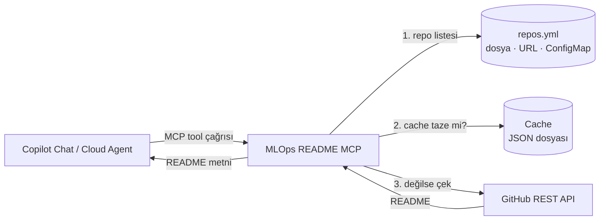

# MLOps README MCP

<!-- mcp-name: com.example/mlops-readmes -->

GitHub repolarının README dosyalarını toplayıp **GitHub Copilot** gibi yapay zekâ asistanlarına [Model Context Protocol (MCP)](https://modelcontextprotocol.io) üzerinden sunan, Python ile yazılmış küçük bir server.

Copilot'a "MLflow ile Kubeflow arasındaki farkı anlat" ya da "DVC'ye nasıl başlarım?" diye sorduğunuzda, model eğitim verisindeki eski bilgiye değil, repoların **güncel README içeriğine** bakarak cevap verir.

- **Tek dosyadan yönetim:** Hangi repoların okunacağı `repos.yml` içinde tanımlanır.
- **Haftalık cache:** README'ler bir kez çekilir, 7 gün boyunca cache'ten sunulur. Böylece GitHub API limiti zorlanmaz.
- **Dayanıklı:** GitHub'a erişilemezse eski cache'teki README sunulmaya devam eder.
- **İki çalışma modu:** Lokal (`stdio`) ya da OpenShift'te merkezi servis (`http`, token korumalı, ölçeklenebilir).

---

## İçindekiler

- [Nasıl Çalışır?](#nasıl-çalışır)
- [Kaynaklar Nereden Geliyor?](#kaynaklar-nereden-geliyor)
- [Hızlı Başlangıç](#hızlı-başlangıç)
- [Yapılandırma](#yapılandırma)
- [Tool'lar](#toollar)
- [OpenShift'e Kurulum](#openshifte-kurulum)
- [Copilot Bağlantısı](#copilot-bağlantısı)
- [Geliştirme](#geliştirme)
- [Proje Yapısı](#proje-yapısı)
- [Bilinen Sınırlar](#bilinen-sınırlar)

---

## Nasıl Çalışır?



1. Copilot bir tool çağırır (örneğin `get_repository_readmes`).
2. Server istenen repoları `repos.yml` içinde bulur.
3. README cache'te varsa ve 7 günden yeniyse doğrudan cache'ten döner.
4. Cache yoksa ya da süresi dolmuşsa README GitHub API'den çekilir, cache'e yazılır ve döndürülür.

## Kaynaklar Nereden Geliyor?

Server'ın okuduğu her şey üç yerden gelir.

### 1. Repo listesi: `repos.yml`

Hangi repoların okunacağını bu dosya belirler. Server dosyayı açılışta **bir kez** okur. Dosyayı değiştirdikten sonra server'ı yeniden başlatmak gerekir. OpenShift'te bu işlem otomatik yapılır.

| Ortam | Dosya nereden okunur? |
|---|---|
| Lokal | `--config repos.yml` (varsayılan) |
| Şirket geneli | `--config-url https://.../repos.yml`: herkes merkezi tek bir dosyayı kullanır |
| OpenShift | `openshift/repos.yml` → ConfigMap → pod içinde `/app/config/repos.yml` |

Şu an tanımlı repolar: **MLflow, Kubeflow, Airflow, DVC, Kedro, Evidently**. Bunların hepsi github.com'daki açık kaynak projelerdir.

### 2. İçerik: GitHub REST API

README içeriği doğrudan GitHub'dan çekilir:

| `repos.yml` ayarı | Çağrılan endpoint |
|---|---|
| (varsayılan) | `GET https://api.github.com/repos/{owner}/{repo}/readme` (reponun ana README'si) |
| `readme_path: docs/README.md` | `GET https://api.github.com/repos/{owner}/{repo}/contents/docs/README.md` |
| `branch: dev` | Yukarıdaki çağrıya `?ref=dev` eklenir |

`GITHUB_TOKEN` tanımlıysa istekler token ile yapılır. Token olmadan yalnızca public repolar okunabilir ve limit saatte 60 istektir. Token ile private repolar da okunur ve limit saatte 5.000 isteğe çıkar.

### 3. Cache: JSON dosyası

Çekilen README'ler `cache.path` ile belirtilen dosyada saklanır:

- **Lokal:** `.cache/readmes.json`. Kalıcıdır, yeniden başlatmada silinmez.
- **OpenShift:** `/tmp/readmes.json`. Her pod'un kendi cache'i vardır ve pod yeniden başlayınca silinir. İlk istekte README'ler tekrar çekilir.

`refresh_repository_readmes` tool'u cache süresini beklemeden README'leri yeniden çeker.

## Hızlı Başlangıç

Gereksinimler: [uv](https://docs.astral.sh/uv/) ve Python 3.11 ya da üstü.

```bash
uv sync                                   # bağımlılıkları kur
uv run mlops-readme-mcp --config repos.yml   # stdio modunda başlat
```

Private repo veya daha yüksek API limiti için token verin:

```bash
GITHUB_TOKEN=ghp_xxx uv run mlops-readme-mcp --config repos.yml
```

VS Code'da projeyi açtığınızda `.vscode/mcp.json` hazır gelir: **MCP: List Servers** → `mlops-readmes` → **Start**. Ardından Copilot Chat'i **Agent** moduna alın.

## Yapılandırma

### `repos.yml`

```yaml
cache:
  ttl_days: 7                 # README kaç gün cache'te kalsın
  path: .cache/readmes.json   # cache dosyası (göreli yollar config dosyasına göre çözülür)

repos:
  - id: mlflow                          # tool'larda kullanılan kısa ad (zorunlu)
    url: https://github.com/mlflow/mlflow   # yalnızca github.com (zorunlu)
    description: MLflow                 # opsiyonel
    branch: master                      # opsiyonel, varsayılan: reponun default branch'i
    readme_path: README.md              # opsiyonel, varsayılan: reponun ana README'si
```

### Ortam değişkenleri

| Değişken | Varsayılan | Açıklama |
|---|---|---|
| `MCP_TRANSPORT` | `stdio` (container'da `http`) | `stdio` veya `http` |
| `MCP_REPOS_CONFIG` | `repos.yml` | Config dosyasının yolu |
| `MCP_REPOS_CONFIG_URL` | — | Merkezi config URL'i (dosya yolunun önüne geçer) |
| `GITHUB_TOKEN` | — | Private repo erişimi ve yüksek API limiti |
| `MCP_AUTH_TOKEN` | — | HTTP modunda tanımlıysa `Authorization: Bearer <token>` zorunlu olur |
| `PORT` / `MCP_HOST` / `MCP_HTTP_PATH` | `8080` / `0.0.0.0` / `/mcp` | HTTP ayarları |
| `LOG_LEVEL` | `INFO` | Log seviyesi |

## Tool'lar

| Tool | Ne yapar? |
|---|---|
| `list_repositories` | Tanımlı repoları, açıklamalarını ve cache durumlarını (son çekilme zamanı, süresi dolmuş mu) listeler. |
| `get_repository_readmes` | Seçilen repoların README'lerini döner. `repo_ids` verilmezse tüm repoların README'lerini döner. |
| `refresh_repository_readmes` | Cache'i beklemeden README'leri GitHub'dan yeniden çeker. |

Her repo ayrıca `readme://<repo-id>` adresinde MCP **resource** olarak da sunulur. Copilot cloud agent şimdilik yalnızca tool'ları destekler.

## OpenShift'e Kurulum

HTTP modunda server şöyle çalışır:

- **Stateless:** Session tutmaz, cevapları düz JSON olarak döner. Sticky session gerekmez ve birden fazla replica sorunsuz çalışır.
- **`/healthz`:** Liveness ve readiness probe'ları için health endpoint'i.
- **Token koruması:** `MCP_AUTH_TOKEN` tanımlıysa token'sız istekler `401` ile reddedilir.
- **OpenShift uyumlu image:** Rastgele UID ve read-only dosya sistemiyle çalışır.

```bash
oc project <namespace>
oc create secret generic mlops-readmes-mcp \
  --from-literal=auth-token="$(openssl rand -hex 32)" \
  --from-literal=github-token=ghp_xxx      # opsiyonel
make deploy
```

`make deploy` Kustomize paketini uygular (`oc apply -k openshift/`), image'ı cluster içinde build eder ve rollout'un bitmesini bekler. Repo listesini değiştirmek için `openshift/repos.yml`'i düzenleyip `oc apply -k openshift/` çalıştırmanız yeterli. Pod'lar otomatik yenilenir.

Ayrıntılar, Nexus/CI senaryosu ve sorun giderme: **[docs/openshift-deployment.md](docs/openshift-deployment.md)**

## Copilot Bağlantısı

**VS Code: OpenShift'teki server'a bağlanma** (`.vscode/mcp.json` ya da kullanıcı ayarları). Token bir kez sorulur ve VS Code'un secret storage'ında saklanır:

```json
{
  "inputs": [
    { "id": "mlops-mcp-token", "type": "promptString", "description": "MLOps MCP token", "password": true }
  ],
  "servers": {
    "mlops-readmes": {
      "type": "http",
      "url": "https://<route-host>/mcp",
      "headers": { "Authorization": "Bearer ${input:mlops-mcp-token}" }
    }
  }
}
```

**GitHub.com Copilot cloud agent**, **MCP registry** ve **kurumsal allowlist** kurulumları için: [docs/enterprise-deployment.md](docs/enterprise-deployment.md). Uçtan uca kurulum rehberi: [docs/KURULUM.md](docs/KURULUM.md).

## Geliştirme

```bash
make test       # testleri çalıştırır (ağ erişimi gerekmez)
make run        # stdio modunda başlatır
make run-http   # http modunda başlatır: http://127.0.0.1:8080/mcp
make image      # Docker image'ını build eder
```

Testler şunları kapsar: stdio açılışı, stateless HTTP üzerinden tool çağrıları, bearer token kontrolü, cache davranışı, GitHub kesintisinde eski cache'e düşme ve URL'den config yükleme.

## Proje Yapısı

```text
mlops-mcp/
├── src/mlops_readme_mcp/
│   ├── server.py      # MCP tool'ları, HTTP uygulaması, token kontrolü, CLI
│   ├── config.py      # repos.yml okuma (dosya veya URL)
│   ├── github.py      # GitHub REST API istemcisi
│   └── cache.py       # TTL'li JSON cache
├── tests/             # pytest testleri
├── openshift/         # Kustomize paketi (build, deployment, service, route, repos.yml)
├── docs/              # Kurulum ve dağıtım rehberleri
├── registry/          # MCP Registry metadata'sı
├── agents/            # GitHub Copilot custom agent tanımı
├── repos.yml          # Lokal repo listesi
└── Dockerfile
```

## Bilinen Sınırlar

- **Yalnızca github.com:** GitHub Enterprise Server ve Azure DevOps repoları henüz desteklenmiyor.
- **Yalnızca README:** `docs/` klasörü gibi diğer dokümanlar okunmuyor. Tek bir dosya `readme_path` ile seçilebilir.
- **Cache pod başına:** OpenShift'te her pod GitHub'a ayrı istek atar ve cache pod yeniden başlayınca silinir. Repo sayısı az olduğu sürece bu sorun yaratmaz.
- **Uzun cevaplar:** `get_repository_readmes` parametresiz çağrılırsa tüm README'ler tek cevapta döner (MLflow README'si tek başına ~32 KB). Belirli repolar için `repo_ids` kullanın.
